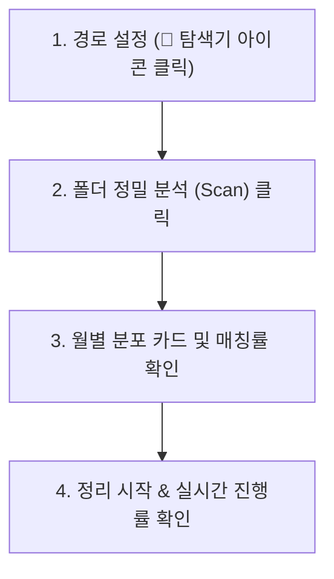

# 📸 Google Takeout Photo Organizer 사용 설명서 (User Manual)

Google 테이크아웃(Takeout)으로 다운로드한 사진과 동영상을 분리된 `.json` 메타데이터와 결합하고, 년/월별 폴더로 자동 정리해 주는 로컬 웹 애플리케이션 가이드입니다.

---

## 🌟 주요 특징

- **스마트 JSON 메타데이터 결합 (정확도 99.6% 이상)**
  - 구글 테이크아웃의 고질적 문제인 긴 파일명 잘림, `photo(1).json` vs `photo.jpg(1).json` 같은 복잡한 중복 넘버링 패턴을 완벽히 인식하여 원본 미디어와 매칭합니다.
- **EXIF 메타데이터 주입 & 타임스탬프 동기화**
  - 촬영일시(UTC/로컬 시간대 변환), GPS 좌표(위도/경도/고도), 사진 설명을 실제 파일 헤더에 영구 기록합니다.
  - Windows 탐색기 기준 **파일 생성일자(`FileCreateDate`)**와 **수정일자(`os.utime`)**를 실제 촬영 시점으로 일치시킵니다.
- **아이폰 라이브 포토 (Live Photo) 쌍 보존**
  - 고유한 식별자를 가진 MOV 동영상과 HEIC/JPG 사진을 한 세트로 인식하여 누락 없이 동일한 월별 폴더로 함께 분류합니다.
- **확장자 누락 자동 복구 (Magic Number)**
  - 확장자가 유실된 파일(예: `IMG_2270`)도 파일 바이너리 헤더 시그니처를 분석하여 실제 포맷(MOV, JPG, HEIC 등)으로 자동 복구합니다.
- **탐색기 폴더 선택 지원**
  - 경로를 직접 타이핑할 필요 없이 📁 아이콘을 클릭하여 마우스로 편하게 폴더를 지정할 수 있습니다.
- **안전한 작업 모드 & 실시간 대시보드**
  - 기본 **복사(Copy)** 모드와 용량 절약형 **이동(Move)** 모드를 지원합니다.
  - **스마트 이어하기(Smart Resume)**: 작업 중단 후 다시 실행해도, 이미 정리된 파일은 크기를 대조하여 초고속으로 자동 건너뛰고 남은 파일부터 이어서 진행합니다. (중복 복사본 방지)
- **내용 동일 사진 중복 제거 (MD5)**: 파일명이 달라도 파일 내용이 완전히 일치하는 중복 사진은 1장만 보존하여 디스크 용량을 대폭 절약합니다.
- **파일명 날짜 형식 통일**: 촬영일시 기반으로 `20250522_143000_파일명.ext` 형태로 자동 변환하여 정렬 편의성을 극대화합니다.
- **멀티스레드 병렬 고속 처리**: 2/4/8개 스레드를 선택하여 수만 장의 사진도 몇 배 빠르게 처리합니다.
- **원본 잔여 파일 청소 (Cleanup)**: 이동 모드 완료 후 남은 수천 개의 빈 폴더와 찌꺼기 `.json` 메타데이터 파일을 원클릭으로 일괄 삭제합니다.
  - 파일 정리가 시작되기 전 **월별 폴더 분포 미리보기**를 제공하며, 실시간 진행률(Progress Bar) 및 콘솔 로그를 제공합니다.

---

## 💻 시스템 요구사항

- **운영체제**: Windows 10 / 11 (64-bit 권장)
- **런타임**: Python 3.9 이상
- **ExifTool**: 별도 설치 불필요 (`bin/` 폴더에 내장 완료)

---

## 🚀 빠른 시작 (3단계)

### 1. 다운로드 및 압축 해제
- GitHub 저장소 우측 상단의 **Code** 버튼 $\rightarrow$ **Download ZIP**을 클릭하여 다운로드합니다.
- 원하는 폴더에 압축을 풉니다.

### 2. 프로그램 실행
- 폴더 안의 **`start.bat`** 파일을 더블 클릭합니다.
- 필요한 패키지(`fastapi`, `uvicorn`, `websockets` 등)가 없을 경우 자동으로 설치됩니다.
- 1~2초 후 기본 웹 브라우저가 자동으로 열리며 대시보드가 나타납니다.
  > *(브라우저가 자동으로 안 뜰 경우 주소창에 `http://127.0.0.1:8000` 입력)*

---

## 🖥️ 화면 사용 가이드



### 1단계: 경로 설정
1. **원본 테이크아웃 폴더 경로**: 
   - 우측의 📁 **폴더 열기** 아이콘을 눌러 구글 테이크아웃 압축을 푼 폴더(예: `Google 포토\2025년의 사진`)를 선택합니다.
2. **정리된 파일 저장 폴더**:
   - 우측의 📁 **폴더 열기** 아이콘을 눌러 정리된 사진들이 저장될 대상 폴더를 선택합니다.

### 2단계: 옵션 확인
- **작업 모드**:
  - `복사 (Copy)`: 원본은 그대로 두고 새 폴더에 복사본을 생성합니다. (가장 안전하며 기본 권장)
  - `이동 (Move)`: 원본 파일을 대상 폴더로 옮겨 디스크 공간을 절약합니다.
- **체크박스 옵션**:
  - `EXIF 메타데이터 직접 주입`: 촬영일시 및 GPS 위치를 파일 내부에 기록 (체크 권장)
  - `확장자 누락 자동 복구`: 시그니처 감지로 확장자 부여 (체크 권장)
  - `라이브 포토 쌍 묶음 보존`: MOV 영상과 사진을 같은 폴더로 함께 분류 (체크 권장)

### 3단계: 폴더 정밀 분석 (Scan)
- **[폴더 정밀 분석 (Scan)]** 버튼을 클릭합니다.
- 상단 카드에 **미디어 파일 수, JSON 매칭률(%), 라이브 포토 쌍, 복구 대상**이 표시됩니다.
- 하단 **월별 폴더 분류 미리보기** 카드에 각 년/월별로 몇 장의 사진이 분류될지 미리 표시됩니다.

### 4단계: 정리 및 메타데이터 주입 시작
- 분석 결과를 확인한 후 **[정리 및 메타데이터 주입 시작]**을 클릭합니다.
- 프로그레스 바가 차오르며, 하단 콘솔 창에 실시간 처리 파일 목록이 스트리밍됩니다.
- `[작업 종료]` 메시지가 뜨면 대상 폴더로 이동하여 정리된 사진을 확인합니다.

---

## 📂 최종 정리된 폴더 구조 예시

```text
정리된_저장폴더/
├── 2024/
│   ├── 2024-11/
│   │   ├── IMG_0123.jpg          (EXIF 촬영일 및 위치 주입 완료)
│   │   └── IMG_0124.mp4
│   └── 2024-12/
└── 2025/
    ├── 2025-01/
    ├── 2025-05/
    │   ├── IMG_0758.JPG          (라이브 포토 이미지)
    │   └── IMG_0758.MOV          (라이브 포토 영상 - 동일 타임스탬프 동기화)
    └── 2025-10/
        └── IMG_2270.mov          (확장자 누락 자동 복원 완료)
```

---

## ❓ 자주 묻는 질문 (FAQ)

**Q. 다른 컴퓨터에서도 실행할 수 있나요?**  
A. 네! 이 폴더 전체를 복사하여 다른 PC로 가져간 뒤 `start.bat`을 더블 클릭하기만 하면 됩니다. (Python만 설치되어 있으면 됩니다)

**Q. 원본 파일이 손상될 위험이 있나요?**  
A. 기본값이 **복사(Copy)** 모드로 설정되어 있으므로 원본 데이터는 전혀 훼손되지 않고 보존됩니다.

**Q. 포트 8000 충돌 에러가 날 때는 어떻게 하나요?**  
A. 기존 실행 중이던 검은색 명령 프롬프트 창을 닫은 후 `start.bat`을 다시 실행해 주시면 됩니다.

---

## 📄 라이선스
MIT License
